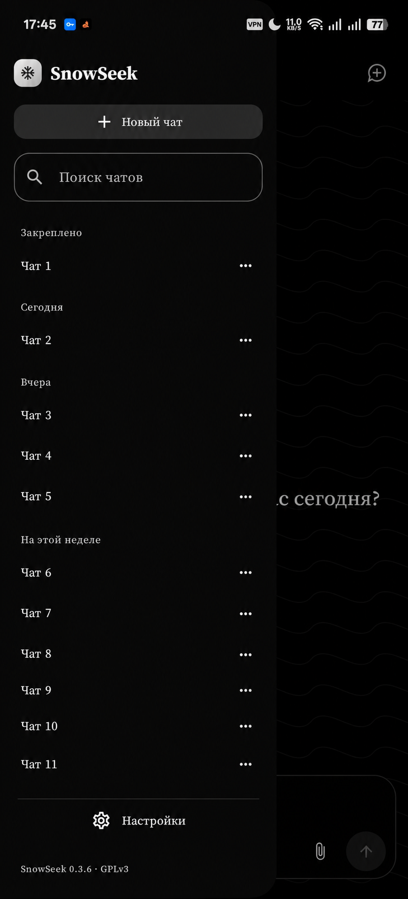
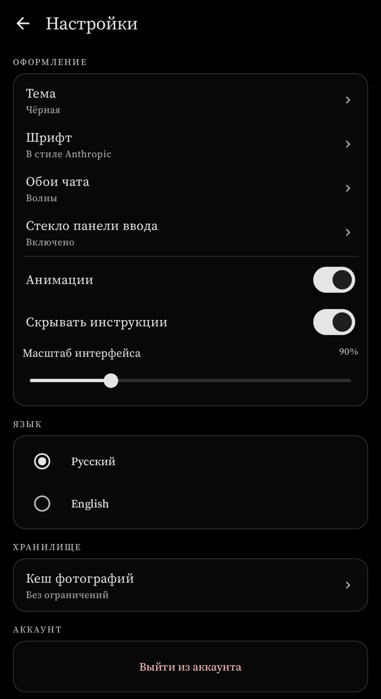
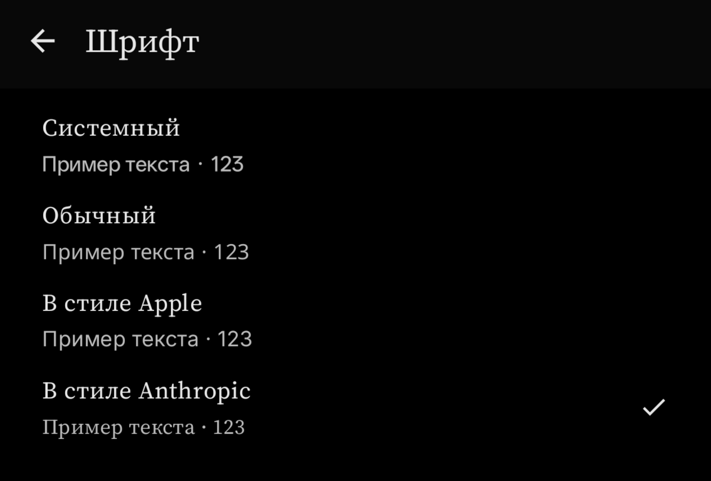
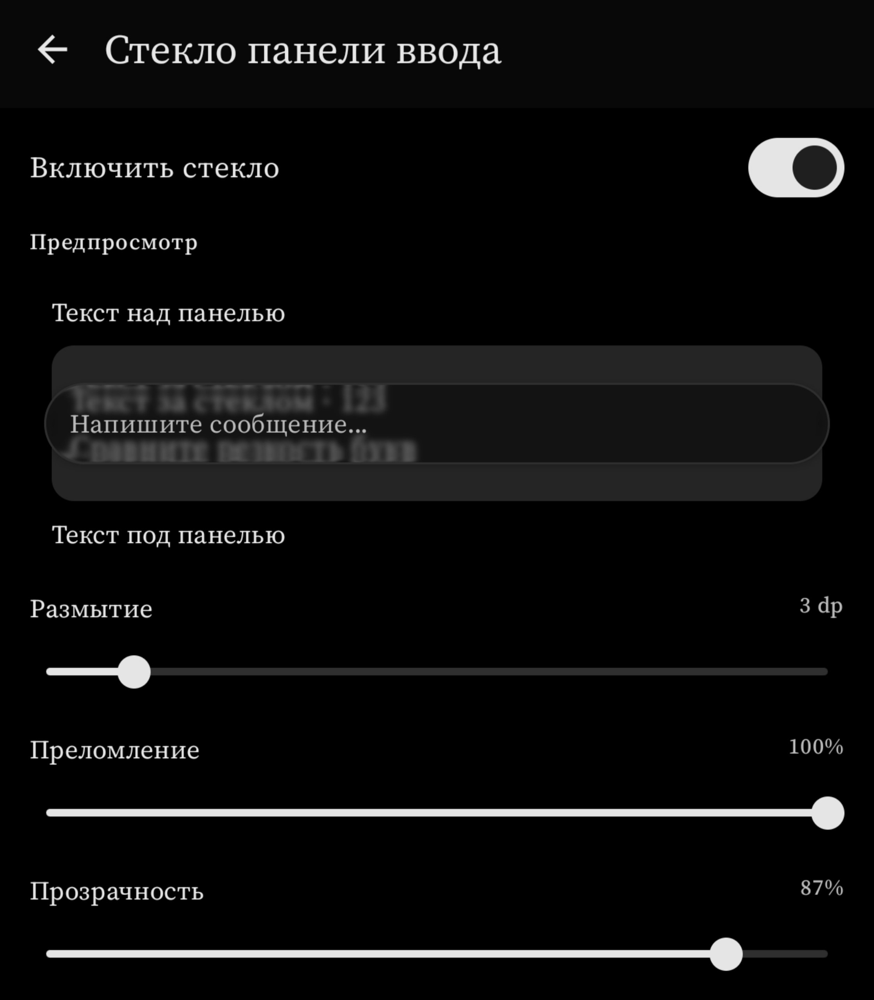
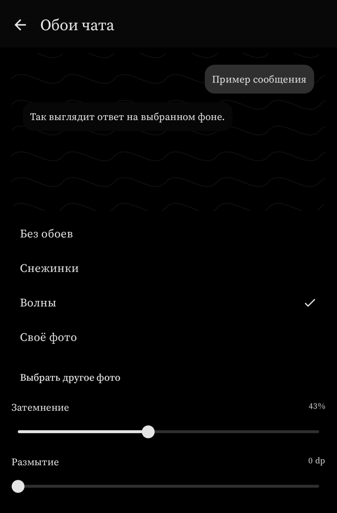

<h1 align="center">SnowSeek</h1>

Неофициальный Android-клиент DeepSeek с нативным интерфейсом.

  

  <a href="https://github.com/cneqq/SnowSeek/releases">Скачать APK</a> ·
  <a href="https://github.com/cneqq/SnowSeek/actions/workflows/android.yml">Сборки</a> ·
  <a href="https://github.com/cneqq/SnowSeek/issues">Сообщить об ошибке</a>

Android 8.0+ · Kotlin · Jetpack Compose · GPLv3

## Скриншоты

<table>
  <tr>
    <th width="50%">История чатов</th>
    <th width="50%">Настройки</th>
  </tr>
  <tr>
    <td align="center" valign="top"></td>
    <td align="center" valign="top"></td>
  </tr>
</table>

<table>
  <tr>
    <th width="33%">Шрифты</th>
    <th width="34%">Стекло</th>
    <th width="33%">Обои</th>
  </tr>
  <tr>
    <td align="center" valign="top"></td>
    <td align="center" valign="top"></td>
    <td align="center" valign="top"></td>
  </tr>
</table>

*На скриншоте истории названия чатов заменены на демонстрационные.*

## Возможности

- **Чаты:** загрузка из аккаунта, поиск по названиям, закрепление, переименование и группы по датам.
- **Ответы:** потоковый текст, рассуждение, поиск в интернете и ссылки на источники. Состояния переключателей сохраняются.
- **Работа с сообщениями:** редактирование, перегенерация, переключение версий, продолжение и остановка ответа.
- **Форматирование:** Markdown, таблицы, формулы, подсветка кода и копирование.
- **Вложения:** фото и файлы, предпросмотр изображений, локальный кеш с выбором лимита.
- **Оформление:** темы, четыре варианта шрифта, масштаб интерфейса, обои и стеклянная панель ввода.
- **Локальные модели:** более 20 моделей разных семейств для общения, быстрых ответов, текстов, программирования, математики и рассуждений. Каталог сгруппирован по задачам; совместимые `.litertlm` и `.gguf` можно импортировать. История локальных чатов хранится на устройстве.
- **Инструкции:** готовые и собственные шаблоны для новых чатов. Русский и английский интерфейс.

## Установка

1. Скачайте APK из [релизов](https://github.com/cneqq/SnowSeek/releases). Отладочные сборки доступны в [Actions](https://github.com/cneqq/SnowSeek/actions/workflows/android.yml), артефакт `SnowSeek-debug`.
2. Установите на Android 8.0 или новее, разрешив установку из выбранного источника.
3. Войдите в аккаунт DeepSeek через приложение. Для Google-входа следуйте подсказкам на экране; на Android 12+ потребуется разрешить возврат по ссылке в SnowSeek.

Для скачивания артефактов Actions может потребоваться вход в GitHub. Debug- и Release-сборки имеют разные ключи подписи.

## Аккаунт и соединение

SnowSeek работает с бесплатной веб-версией DeepSeek и не использует платный Developer API. Проект не связан с DeepSeek. Внутренний протокол сервиса может меняться и требовать обновления приложения.

Вход проходит через официальный сайт DeepSeek. Приложение хранит токен сессии зашифрованным с помощью Android Keystore. Фото и файлы отправляются в DeepSeek при прикреплении; кеш фотографий и настройки хранятся на устройстве. История сообщений загружается из аккаунта.

При обрыве потока SnowSeek пытается получить ответ из истории. Приложение не отправляет запрос повторно автоматически, чтобы не создавать дубликаты. Рекламы и аналитики нет.

## Лицензия

[GNU GPLv3](LICENSE). Сторонние компоненты и их лицензии перечислены в [THIRD_PARTY_NOTICES.md](THIRD_PARTY_NOTICES.md).
